# Target, sketch, result

Each picture shows the target screenshot, the sketch as drawn, and what was built.

## Round 45

**c1-desert-camp**: likeness 80.3, 17 strokes, 32 words, 0 fixes

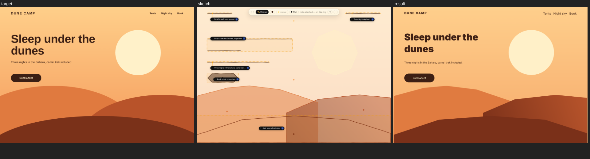

**c2-watchmaker**: likeness 90.5, 19 strokes, 56 words, 1 fixes

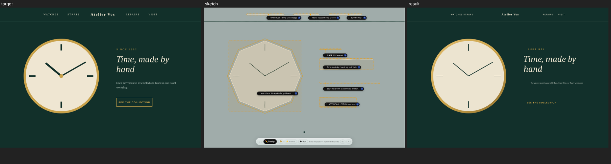

**c3-pizza-oven**: likeness 79.8, 20 strokes, 59 words, 1 fixes

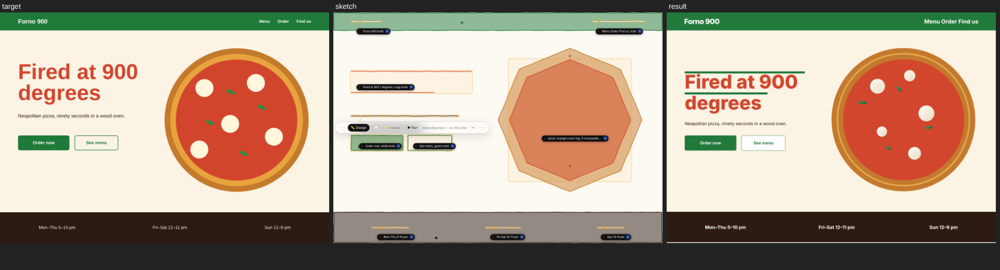

**c4-bike-repair**: likeness 80.6, 15 strokes, 68 words, 1 fixes

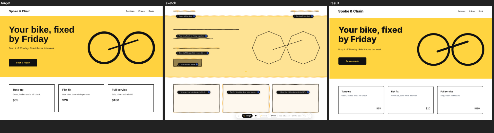

**c5-candle-studio**: likeness 88.2, 18 strokes, 35 words, 0 fixes

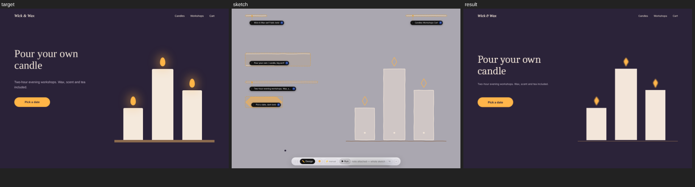

**e1-car-rental**: likeness 78.7, 19 strokes, 79 words, 2 fixes

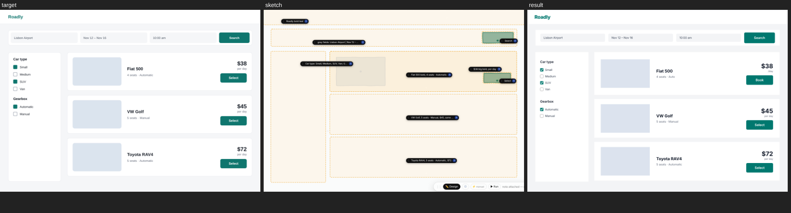

**e2-two-factor**: likeness 92.0, 17 strokes, 48 words, 1 fixes

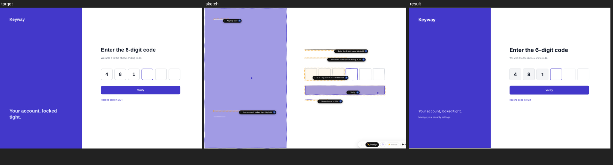

**e3-audio-mixer**: likeness 76.8, 20 strokes, 52 words, 1 fixes

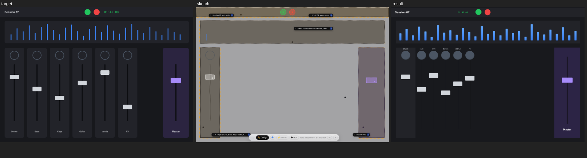

**e4-edit-profile**: likeness 84.6, 18 strokes, 35 words, 0 fixes

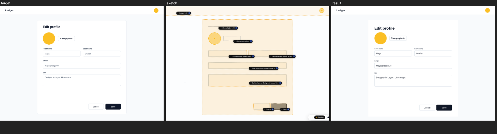

**e5-signup-funnel**: likeness 84.7, 17 strokes, 72 words, 1 fixes

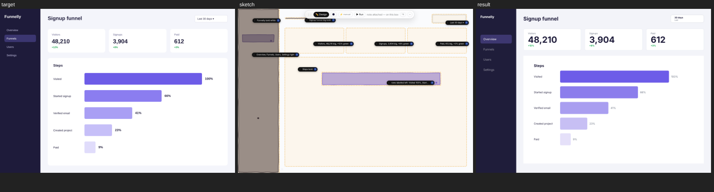

## Round 46

**c1-rocket-launch**: likeness 90.6, 18 strokes, 34 words, 0 fixes

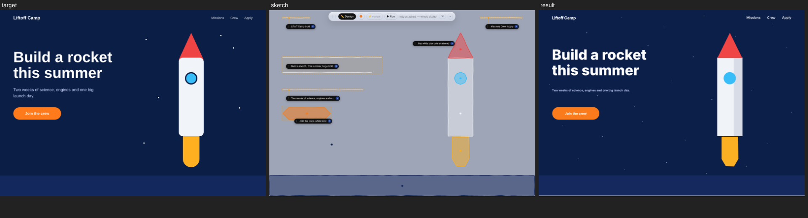

**c2-greenhouse**: likeness 86.0, 18 strokes, 42 words, 0 fixes

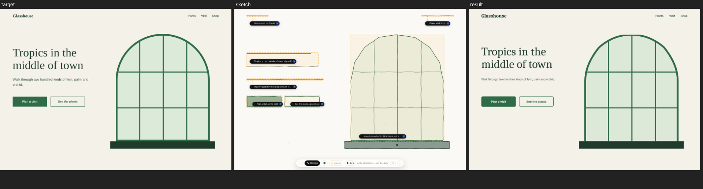

**c3-domino-cafe**: likeness 86.2, 16 strokes, 44 words, 0 fixes

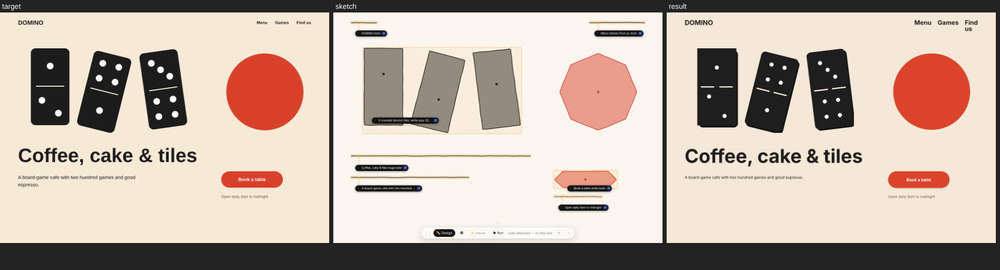

**c4-tennis-club**: likeness 65.0, 14 strokes, 58 words, 1 fixes

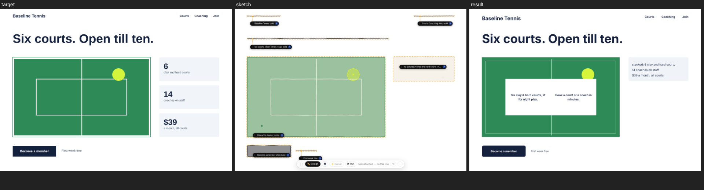

**c5-paint-store**: likeness 72.3, 17 strokes, 56 words, 0 fixes

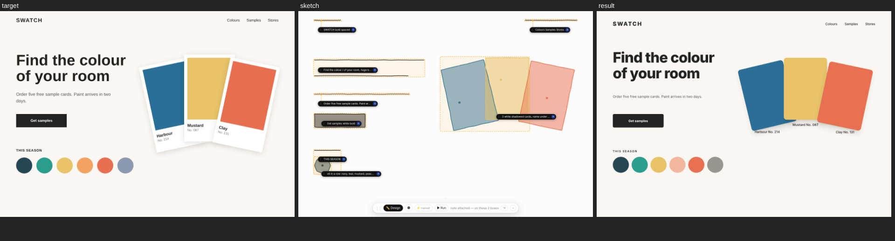

**e1-library-search**: likeness 80.3, 19 strokes, 60 words, 0 fixes

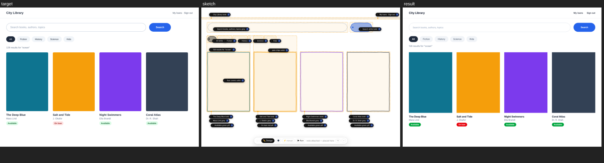

**e2-team-roster**: likeness 88.9, 13 strokes, 60 words, 1 fixes

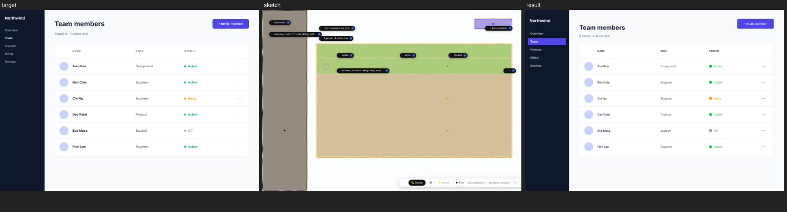

**e3-thermostat**: likeness 79.8, 14 strokes, 37 words, 0 fixes

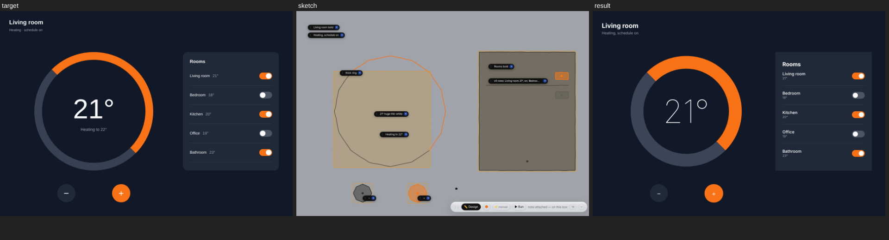

**e4-doctor-booking**: likeness 79.5, 18 strokes, 56 words, 1 fixes

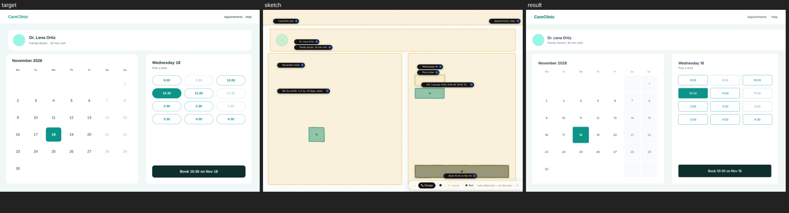

**e5-loan-calculator**: likeness 55.9, 16 strokes, 68 words, 1 fixes

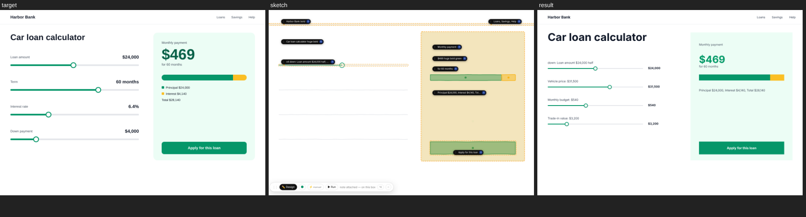

## First skeptic re-sketch

**r45 c2-watchmaker**: likeness 85.6, 12 strokes, 52 words, 2 fixes

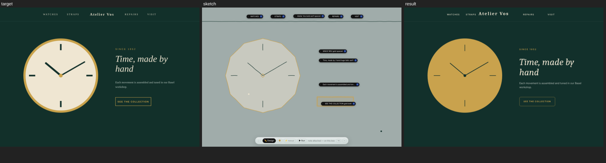

**r45 e3-audio-mixer**: likeness 93.3, 22 strokes, 51 words, 1 fixes

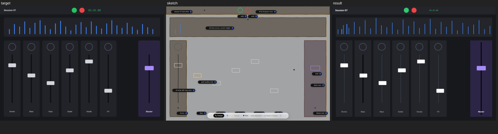

**r46 c1-rocket-launch**: likeness 95.8, 19 strokes, 50 words, 2 fixes

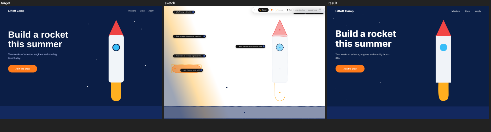

**r46 e1-library-search**: likeness 64.4, 14 strokes, 94 words, 2 fixes

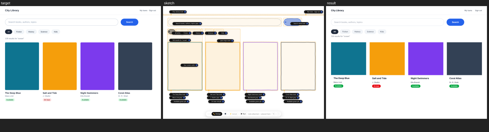

## Second skeptic re-sketch

**r45 c4-bike-repair**: likeness 86.6, 11 strokes, 100 words, 3 fixes

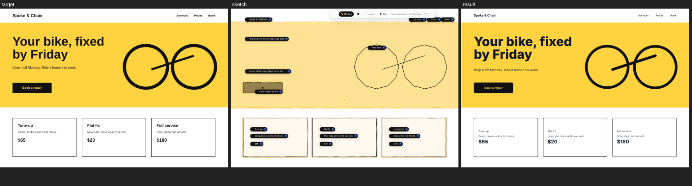

**r45 e1-car-rental**: likeness 86.3, 16 strokes, 81 words, 1 fixes

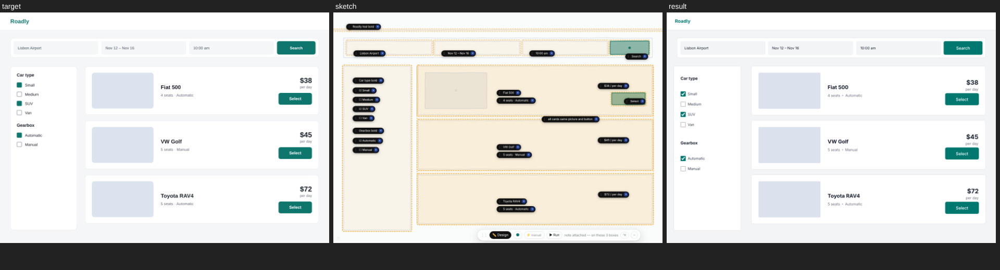

**r46 c5-paint-store**: likeness 69.9, 18 strokes, 87 words, 2 fixes

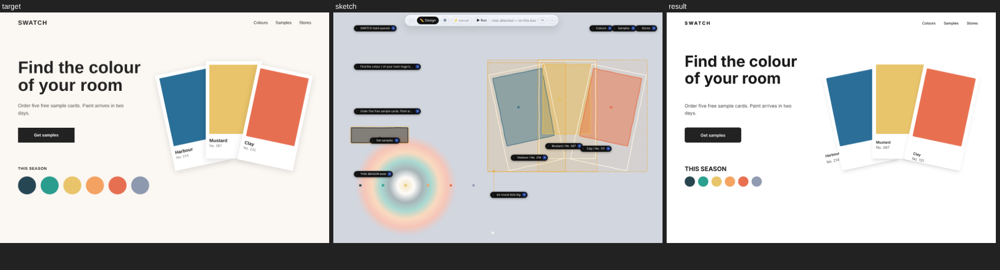

**r46 e2-team-roster**: likeness 87.8, 14 strokes, 81 words, 1 fixes

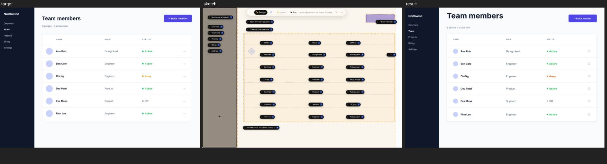

## Final check: four more redraws from a clean copy

**r46 c4-tennis-club**: likeness 89.8, 15 strokes, 48 words, 1 fixes

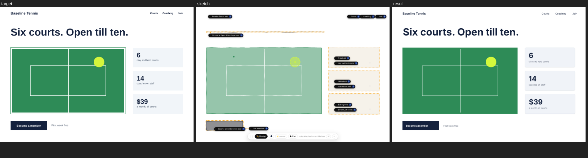

**r46 c2-greenhouse**: likeness 85.1, 15 strokes, 56 words, 1 fixes

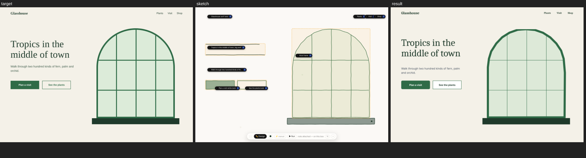

**r46 e3-thermostat**: likeness 82.3, 14 strokes, 45 words, 1 fixes

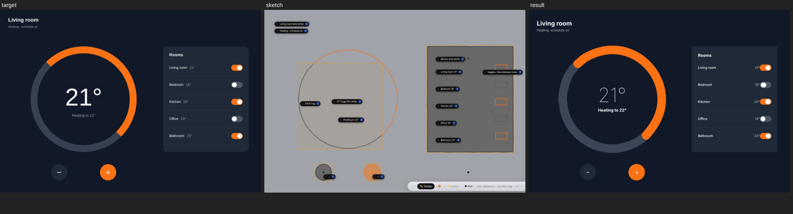

**r46 e5-loan-calculator**: likeness 66.7, 19 strokes, 69 words, 1 fixes

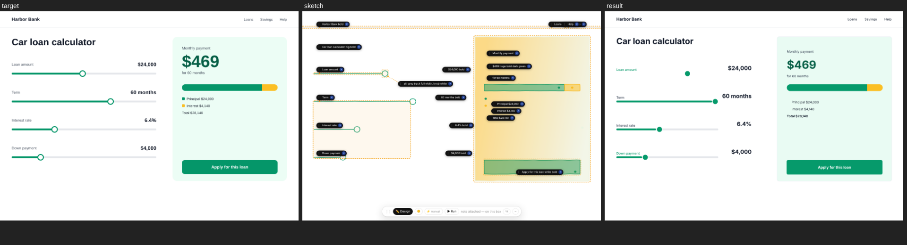

