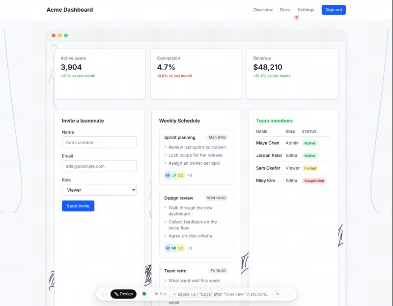
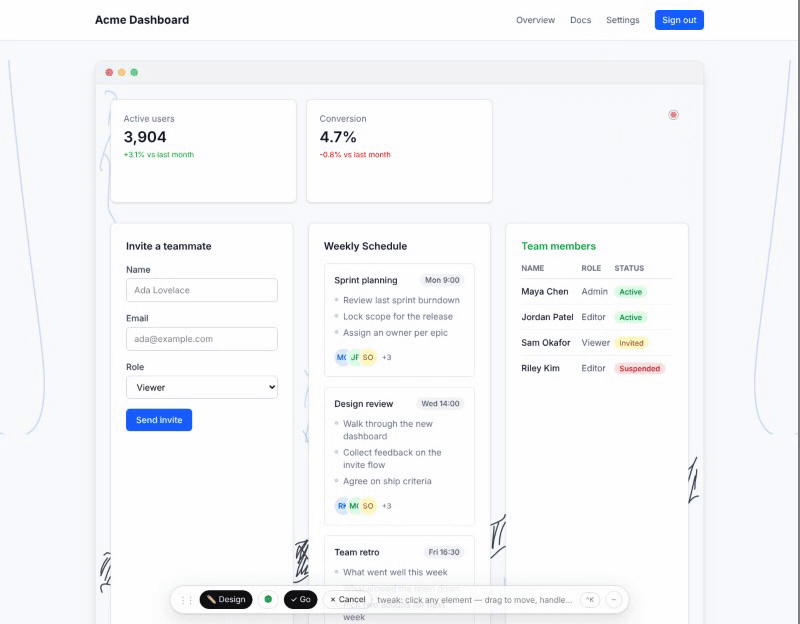
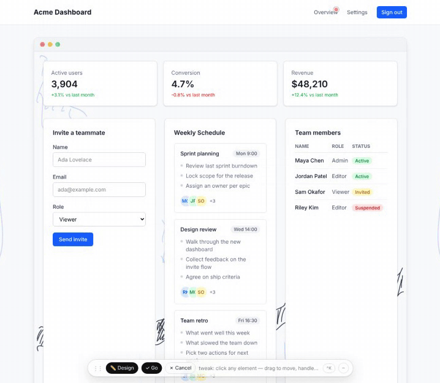
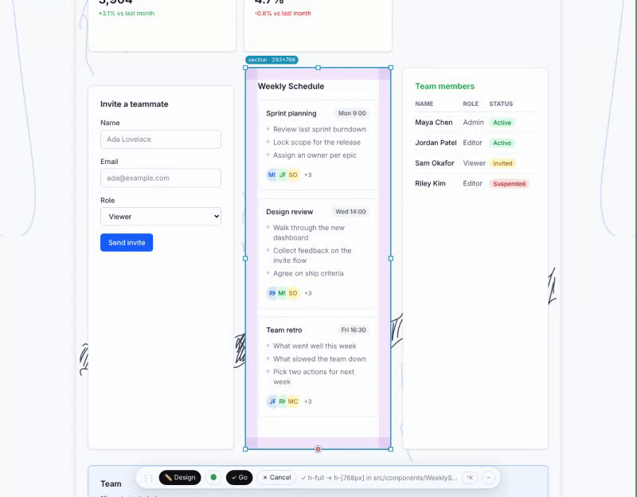

# Motion proof: every gesture, filmed and timed

Generated by `node tests/e2e/motion-proof.mjs` (goal loop n14) on 2026-10-19. The demo app, headless Chromium, no model calls (every edit is written to the code by a codemod).

How to read it: **visible** is the time from letting go (pen lift or mouse release; for drags, the first move) to the first animation frame where the page, or the dragged element under the pointer, has changed. **Frames / fps / gap** are the browser's own animation frames over the second after the gesture: 60 fps is a 16.7 ms gap.

## Watch it

Each GIF is a slice of one continuous run (ten edits back to back, then ten undos), cropped to the part of the page that moved. The red dot is the pointer. The film is slowed to 1.6 s between gestures (0.9 s between undos) so each one can be seen; the timed run below has 0.25 s.

### Erase: erase stat card "Revenue"



### Add: add nav link "Docs" after "Overview"


### Reorder: reorder card 1→3


### Move: move form down



### Resize: resize card taller



### Recolour: recolour "Team members" green


### Undo: ten undos (10 named)



## Frame timing: ten mixed edits in a row (unfilmed run)

10 edits in 13.6 s, 5 drags + 5 pen edits written to code, 0 model calls. All checks passed.

A card dragged out of a row that clips its content travels as a lifted copy under the pointer (the card itself dims in place); that copy is what you see move first, and the row reflows once the pointer reaches another slot.

| Edit | Visible | Shows first | Frames (1 s) | fps | gap p50 / p95 |
|---|---|---|---|---|---|
| reorder card 1→3 | 3 ms | page | 60 | 60.2 | 16.6 / 22.7 ms |
| erase nav link "Reports" | 12 ms | page | 60 | 60 | 16.7 / 27.3 ms |
| resize card taller | 3 ms | page | 61 | 60.2 | 16.7 / 20.5 ms |
| recolour "Team members" green | 19 ms | page | 60 | 60.4 | 16.7 / 22.5 ms |
| add nav link "Docs" after "Overview" | 20 ms | ghost | 60 | 60.5 | 16.7 / 19.8 ms |
| erase stat card "Revenue" | 12 ms | page | 60 | 60 | 16.6 / 21.2 ms |
| move form down | 1 ms | page | 61 | 60.3 | 16.7 / 18.9 ms |
| recolour nav link "Settings" green | 11 ms | page | 60 | 60 | 16.7 / 19.5 ms |
| reorder nav link 1→2 | 1 ms | page | 60 | 60.1 | 16.7 / 21.7 ms |
| resize grid item taller | 2 ms | page | 60 | 60.1 | 16.7 / 20.2 ms |

| Undo | Visible | Frames | fps | gap p50 / p95 |
|---|---|---|---|---|
| 1. resized that part | 21 ms | 18 | 48.6 | 18.3 / 52.3 ms |
| 2. changed the order | 27 ms | 22 | 60.1 | 16.7 / 20.6 ms |
| 3. changed the colour you painted | 15 ms | 21 | 60 | 16.7 / 23 ms |
| 4. moved that part | 20 ms | 22 | 60.1 | 16.6 / 19.2 ms |
| 5. removed what you crossed out | 9 ms | 22 | 59.7 | 16.7 / 23.6 ms |
| 6. added what you drew | 39 ms | 22 | 60.1 | 16.7 / 22.6 ms |
| 7. changed the colour you painted | 9 ms | 22 | 60.2 | 16.7 / 18.2 ms |
| 8. resized that part | 34 ms | 19 | 54.1 | 16.8 / 40 ms |
| 9. removed what you crossed out | 8 ms | 23 | 60.6 | 16.8 / 19.5 ms |
| 10. changed the order | 32 ms | 60 | 60 | 16.7 / 18.7 ms |

## Per-gesture motion runs

From the single-gesture e2es (`motion-erase`, `motion-reorder`, `motion-resize`, `motion-add-recolour`), as last written to docs/motion.

| Gesture | Visible | Motion | Frame gap p50 / p95 / max |
|---|---|---|---|
| Erase (scribble) | 12 ms | fades over 7 frames, neighbour glides 124 px over 11 frames | 16.7 / 16.8 / 16.8 ms |
| Drag to reorder | 27 ms into the drag | row reflows live, glides over 11 frames, held until the code lands | 16.7 / 16.8 / 16.8 ms |
| Resize by edge | 11 ms into the pull | page reflows live; code height 182 px = dragged 182 px | 16.7 / 16.7 / 16.8 ms |
| Add (caret + word) | 12 ms | grows in, neighbour glides | 16.7 / 16.8 / 50.0 ms |
| Recolour (ring) | 13 ms | colour eases over 8 frames | 16.7 / 16.8 / 50.0 ms |

## Shared plane

22/22 scripted edits landed in code matching what was already on screen, with no flash or jump (`tests/e2e/shared-plane.mjs`).

## The filmed run

Frame stats while filming are lower because the video encoder shares the 2 CPU cores with the page; they are listed so nothing is hidden.

| Edit | Visible | Frames (1 s) | fps | gap p50 / p95 |
|---|---|---|---|---|
| reorder card 1→3 | 9 ms | 41 | 40.6 | 26 / 42.3 ms |
| erase nav link "Reports" | 12 ms | 51 | 51.2 | 16.9 / 42.6 ms |
| resize card taller | 2 ms | 49 | 48.4 | 16.8 / 35.3 ms |
| recolour "Team members" green | 43 ms | 54 | 55.7 | 16.8 / 28.5 ms |
| add nav link "Docs" after "Overview" | 47 ms | 47 | 48.7 | 19 / 34.5 ms |
| erase stat card "Revenue" | 15 ms | 54 | 54.3 | 16.8 / 35.7 ms |
| move form down | 2 ms | 44 | 44 | 16.8 / 48 ms |
| recolour nav link "Settings" green | 23 ms | 57 | 58.1 | 16.9 / 27.4 ms |
| reorder nav link 1→2 | 2 ms | 38 | 37.4 | 24.7 / 47.4 ms |
| resize grid item taller | 2 ms | 51 | 50.6 | 16.8 / 41.4 ms |

## Re-run it yourself

```sh
npm ci && npm run build
export S2C_CHROMIUM=/path/to/chromium   # optional
node tests/e2e/mixed-ten.mjs            # timed run -> docs/motion/mixed-ten.json
node tests/e2e/motion-proof.mjs         # film + GIFs + this page
```
